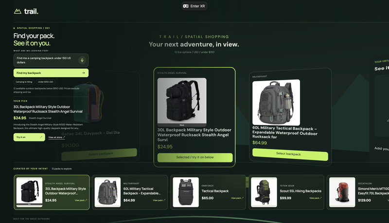
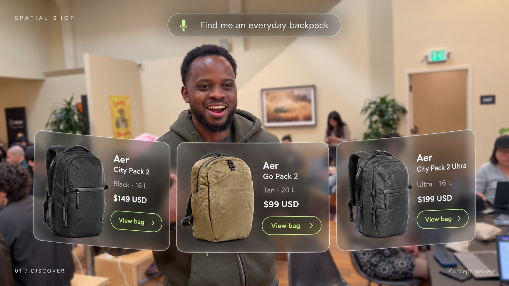
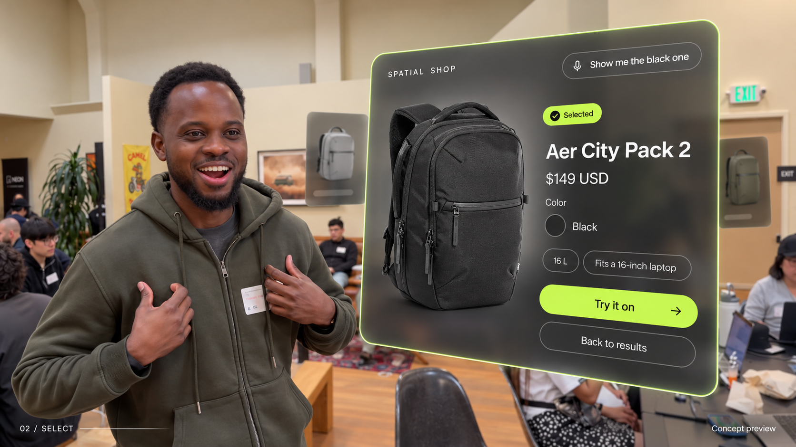
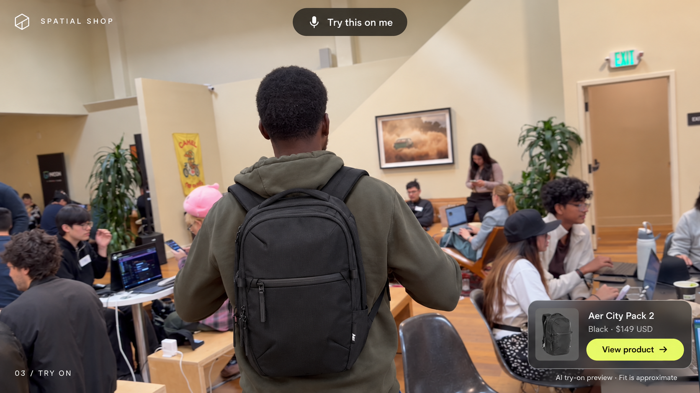

# Trail — Fast Forward Spatial Shop

A voice-driven shopping agent that lets people discover backpacks, swipe through products in VR, and preview a selected backpack on a human. An entry concept for the Fast Forward Virtual Hackathon.

**Status:** Working first build from Meta's IWSDK starter. Live Shopify search, desktop browsing, spatial cards, controller selection, laptop webcam capture, and AI try-on are integrated. Live generation has been tested with a selected camping backpack. Physical webcam/Quest testing and deployment remain.



[Verification notes](design/VERIFICATION.md) distinguish tested behavior from the remaining headset and AI checks.

## Run locally

Requires Node 22.12+ (or another version supported in `package.json`).

```sh
npm ci
npm run dev
```

Open http://localhost:5173. Search, select a pack, choose **Try it on**, then **Use webcam**, upload a photo, or select **Use the video frame**. Product results are live; the app never substitutes fixture inventory. Use the microphone button where browser speech recognition is supported; typing follows the same search path.

On a laptop, choose **Use webcam**, allow camera access, frame your shoulders and torso, then **Capture photo**. You can retake it before generating. A front view shows straps; a rear or three-quarter view shows more of the bag. The preview stays local, and only the captured still is sent when you choose **Generate my try-on**. Capture, Stop camera, closing the dialog, hiding the tab, or entering VR turns the camera off. Webcam capture requires HTTPS or localhost; plain HTTP over a LAN will not work.

For the managed Meta desktop emulator:

```sh
# Stop the plain dev server first if it is running.
npm run dev:managed
```

In VR, use **Find backpacks**, point and trigger to select a card, and use the right thumbstick or Previous/Next buttons to browse. Prepare your photo and access token in the browser before entering VR. **Try on selected** displays the generated preview in the panel to your right. Desktop and VR share selection within the same tab.

## Enable AI try-on

Copy `.env.example` to `.env.local`, set `AI_GATEWAY_API_KEY` and a private `TRY_ON_ACCESS_TOKEN` of at least 16 characters, then restart the server. Enter the private demo token in the try-on dialog. Never use `VITE_` prefixes for credentials or commit real values. The token guards the paid generation endpoint; it stays only in browser memory.

The endpoint uses AI SDK and `google/gemini-3.1-flash-image` through Vercel AI Gateway. Override `AI_GATEWAY_IMAGE_MODEL` if needed. It revalidates the selected Shopify variant and sends its verified product image plus the selected human photo to the model. Photos are limited to 2 MB and are not persisted by the application. Generation is an approximate image visualization, not body tracking or a 3D fit simulation.

## Deploy and test

Import this repository into Vercel using its Vite preset. `vercel.json` routes `/api/*` to the Node function and serves the built frontend. Configure the server environment variables to enable generation. Open the deployed HTTPS URL in Quest Browser and enter VR. `npm run preview` serves static output only; use the dev server or Vercel for API-backed testing.

```sh
npm run typecheck
npm test
npm run build
```

The build retains desktop IWER emulation from the starter. Real webcam capture, headset readability, hand/controller comfort, and microphone behavior still need hardware testing. The integrated agent currently uses a bounded tool workflow with explicit budget parsing, not multi-turn LLM conversation. It uses Shop MCP for discovery; no checkout/UCP purchase flow is implemented.

## The experience

**“Find me a camping backpack under 150 US dollars.”**

1. **Speak the request.** The user asks for a camping backpack under $150 USD.
2. **Search Shopify.** The agent searches through Shopify's Shop MCP and checks that the returned options meet the camping use case and have a listed product price below $150 USD. Shipping and taxes are separate unless explicitly quoted.
3. **Swipe through options.** The user swipes through shopping cards in the VR scene to compare backpack images, prices, and relevant details.
4. **Select in VR.** The user clicks a backpack card using the VR interface.
5. **See it on the human.** The agent generates a preview of the selected backpack worn by the person in a captured image or video frame, then displays that try-on in the scene.

The end goal is a continuous **search → swipe → select → try-on** experience. If no camping backpacks meet the budget, the agent explains that instead of silently showing unsuitable or more expensive products.

The first device target is Meta Quest using WebXR, with a desktop preview for development and demos. Desktop emulation uses the Quest 3 profile.


## End goal storyboard

These generated images illustrate the intended interaction using frames from the demo video. They are concept mockups, not screenshots of a working app. The initial artwork uses everyday Aer backpacks, including a $199 alternative; it predates the camping request and does not represent a validated result set for the under-$150 budget. The implemented search must enforce the use case above.

### Browse and swipe

The agent presents product cards in a spatial carousel. The user swipes to compare options.



### Select a backpack in VR

Clicking a card selects the backpack and reveals its details and a try-on action.



### Preview the backpack on the human

The agent applies the selected backpack to the person's captured image and shows the generated result. This is an approximate appearance preview; it does not establish physical fit, real-time body tracking, or a fitted 3D model.



## Project documents

The camping backpack flow in this README is the current use case.

- [Hackathon entry brief](docs/ENTRY.md): problem, concept, demo story, and scope.
- [Implementation architecture](docs/ARCHITECTURE.md): components, data flow, and integration decisions.
- [MVP build checklist](docs/ROADMAP.md): milestones and acceptance criteria.

## First build target

Complete one path: spoken camping request → live matching backpacks below $150 USD → swipeable spatial cards → VR selection → generated backpack try-on on the human. Use image-based product cards and a captured-person preview for the first build.

The implementation uses three visible spatial image cards backed by up to twelve live results. Browse changes which products are visible; selection and try-on remain tied to the exact variant. Shipping and tax are excluded from the product-price budget. Generated UI is composed from real product data; no product price or inventory is invented.

## Starter attribution

Based on [Meta's IWSDK v0 starter](https://github.com/meta-quest/iwsdk-v0-template) at commit `5185128c864e053d31741c30fa3dccf06ef77797`, with IWSDK 1.0.1. The Apache-2.0 license and upstream copyright notices are retained. The original demo room, robot and cube are replaced with the camping showroom. The storyboard and demo frame are supplied project assets; third-party catalog imagery remains served from its original URLs.

## References

- [Shop MCP quickstart](https://shop.dev/docs/quickstart)
- [Fast Forward builder resources](https://vercel.notion.site/Builder-Resources-Fast-Forward-3f3e06b059c4818eba9ada18e6f32dc0)
- [Shopify Global Catalog MCP](https://shopify.dev/docs/agents/catalog/global-catalog)
- [Shopify catalog integration tutorial](https://shopify.dev/docs/agents/get-started/search-catalog)
- [Meta WebXR overview](https://developers.meta.com/vr/documentation/web/webxr-overview/)
