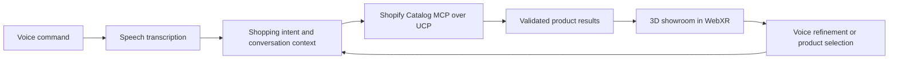

# Fast Forward Spatial Shop

A voice-driven shopping agent that turns a spoken request into a product collection displayed in a 3D space. An entry concept for the Fast Forward Virtual Hackathon.

**Status:** Planning repository. The application, live Shopify integration, and headset experience are not implemented yet.

## The experience

Say “Show me black running shoes under 100 US dollars.” The agent interprets the request, searches Shopify's catalog through its UCP-compatible MCP interface, and presents matching products in a spatial showroom. Say “Only waterproof options” to refine the collection, then select a product to inspect its details.

The proposed first device target is Meta Quest using WebXR, with a desktop preview for development and demos. The exact Meta device remains to be confirmed.

## Project documents

- [Hackathon entry brief](docs/ENTRY.md): problem, concept, demo story, and scope.
- [Technical plan](docs/ARCHITECTURE.md): components, data flow, and integration decisions.
- [MVP build checklist](docs/ROADMAP.md): milestones and acceptance criteria.

## First build target

Complete one path: spoken request → live matching products → selectable product cards in a 3D scene. Product images on spatial cards are sufficient for the MVP; full 3D product models are an enhancement when suitable assets are available.

There are no installation or run commands yet because this repository currently contains project documentation only.

## References

- [Shopify Global Catalog MCP](https://shopify.dev/docs/agents/catalog/global-catalog)
- [Shopify catalog integration tutorial](https://shopify.dev/docs/agents/get-started/search-catalog)
- [Meta WebXR overview](https://developers.meta.com/vr/documentation/web/webxr-overview/)
