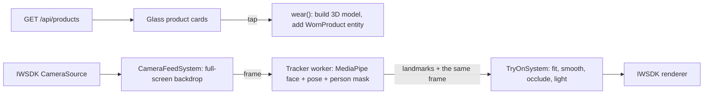

# Fast Forward Try-on (camera-first IWSDK app)

A camera-first take on the [Fast Forward Spatial Shop](../README.md) idea: the app
opens straight into a full-screen camera view, shows the catalog as translucent
cards over the video, and puts the product you pick **on you, live**. It tracks
your face and body every frame, so sunglasses turn with your head, a cap sits
on your head, and a backpack rides on your shoulders and shows its front
pocket when you turn around.

Built from [Meta's IWSDK v0 template](https://github.com/meta-quest/iwsdk-v0-template)
(IWSDK 1.0.1, Vite, TypeScript).

## Run it

Requires Node 22.12+ (see `.nvmrc`).

```sh
cd camera-try-on
npm install
npm run dev
```

Open http://localhost:5173 and allow camera access. Tap a card to try it on.
Tap it again (or **Take off**) to remove it. Pick colours with the swatches.
You can wear one item per slot at once: glasses, a cap and a backpack together.

Camera access needs a secure context: `localhost` works, and so does any
HTTPS deployment. To test on a phone over your LAN, run
`IWSDK_DEV_HTTPS=1 npm run dev` and open the `https://<your-ip>:5173` address.

### No webcam? Use a test image or video

Append `?demo=<url>` to use a file instead of the camera, and add `&mirror=1`
for a selfie-style picture:

```
http://localhost:5173/?demo=/test-media/portrait.jpg&mirror=1
```

Files in `public/test-media/` are git-ignored, so drop your own clips there.
MediaPipe's sample images work well:
`https://storage.googleapis.com/mediapipe-assets/portrait.jpg` (face) and
`https://storage.googleapis.com/mediapipe-assets/business-person.png` (upper body).

## How it works



- **Camera.** `CameraFeedSystem` uses IWSDK's built-in `CameraSource`
  component (`features.camera` in `iwsdk.config.json`). It prefers the
  front camera, falls back to any camera, and draws the feed full screen as
  the scene backdrop, cover-fit and mirrored for selfies.
- **Tracking.** A module worker runs MediaPipe Face Landmarker (478 points)
  and Pose Landmarker (33 points, metric world landmarks, person
  segmentation), GPU first and CPU as a fallback. Only the detectors the
  current outfit needs run. They preload in the background once the camera
  is on.
- **Zero lag between video and product.** Each analysed frame comes back
  with its landmarks. While you wear something, the backdrop shows that exact
  frame, so the product never trails behind your head.
- **Fitting** (`src/body-fit.ts`, unit-tested). Head anchors come from eye
  corners, forehead and chin. Scale uses the eye distance, so frames match
  your face size at any distance. The torso anchor uses metric world
  landmarks for orientation, and its scale is the ratio of on-screen to
  metric size, which stays correct when you stand side-on. Placing models
  this way is perspective-equivalent to true-size objects at your real
  distance.
- **Facing direction.** Pose models keep left/right labels and report a
  "visible" face even from behind. The fit checks where the nose points
  relative to the shoulders, so turning around swings the pack to face the
  camera.
- **Feels worn, not stuck on.**
  - Smoothing: a One Euro filter on position and log-scale, plus adaptive
    slerp on rotation.
  - Occlusion: an invisible head stand-in hides far temple arms and the back
    of the cap. The person segmentation mask hides the part of a backpack
    that is behind you.
  - Fit: the harness re-shapes to your shoulder width and torso length.
  - Lighting: room colour and brightness sampled from the camera drive the
    product lighting. Frames and lenses get studio reflections.
- **Responsive UI** (`src/ui.ts`, `src/style.css`). Glass cards and the
  detail sheet adapt from phones to desktop and short landscape screens, and
  respect safe areas. Status hints guide you ("Step back so your shoulders
  and hips are in view"). You can also take a photo, save or share it, and
  use a demo bag.

## Backend

`server/http.ts` is a fetch-style handler used by the Vite dev and preview
servers (see `vite.config.ts`) and by the Vercel function in `api/index.ts`.

| Route | Returns |
| --- | --- |
| `GET /api/products` | `{ products: Product[] }`, the sample catalog in `server/catalog.ts` |
| `GET /api/products/:id/image.svg?variant=` | Transparent product art for each colour variant |

The `Product` contract is in `src/products.ts`: id, name, brand, category,
price, description, `imageUrl`, colour `variants` and a `tryOn` style
(`glasses` / `cap` / `backpack` and its parameters). To use a real catalog,
replace `listProducts()` and keep the contract. Every product needs a
`tryOn` style so the app knows how to fit it.

## Project layout

```
iwsdk.config.json         camera feature on, XR offer off, no scene content
src/index.ts              World.create + system registration + UI
src/camera-feed-system.ts CameraSource lifecycle, backdrop, viewport mapping
src/try-on-system.ts      tracking → anchors → models, occlusion, lighting
src/tracker*.ts           MediaPipe worker and its main-thread client
src/body-fit.ts           landmark → camera-space maths (pure, tested)
src/models/               procedural glasses, cap and backpack
src/wardrobe.ts           wear / take off (WornProduct entities)
src/ui.ts, style.css      overlay UI
server/, api/             product API and SVG product art
tests/                    node:test suites
```

## Verify

```sh
npm run typecheck
npm test
npm run build
```

## Deploy

On Vercel, import the repository and set **Root Directory** to
`camera-try-on`. `vercel.json` routes `/api/*` to the function and serves
the Vite build.

## Status

Typecheck, unit tests and the production build pass. Try-on was checked in
a desktop browser with still images: frontal face (glasses, cap, both
together), frontal upper body and a back view (backpack), on phone and
desktop viewports. It has **not** been tested with a live webcam yet.
Motion smoothing, real-time frame rate and lighting changes need a pass on
real devices. The first try-on downloads the MediaPipe models from Google's
CDN (about 13 MB for both detectors), so it can take a few seconds on a slow
connection.
